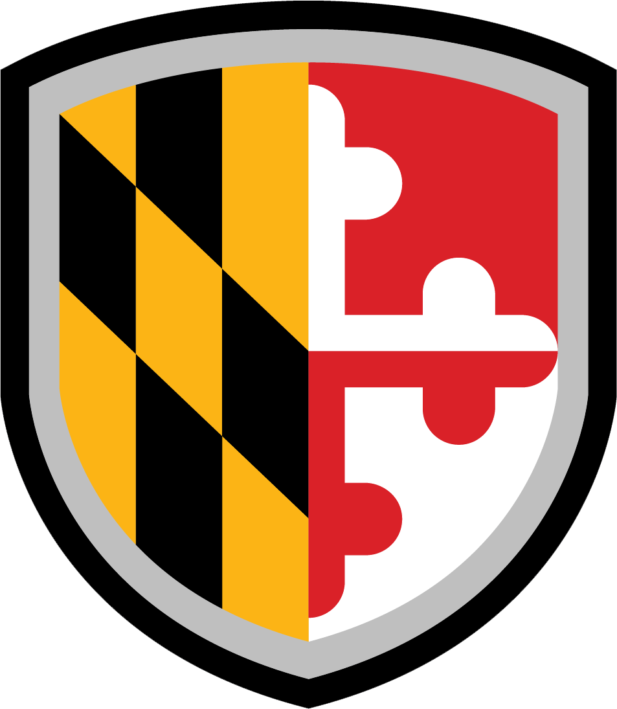
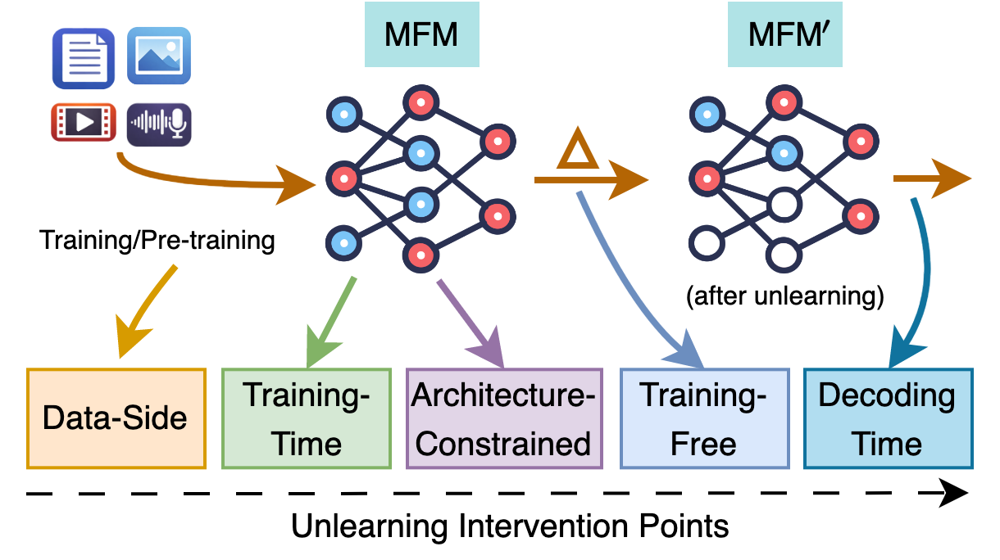
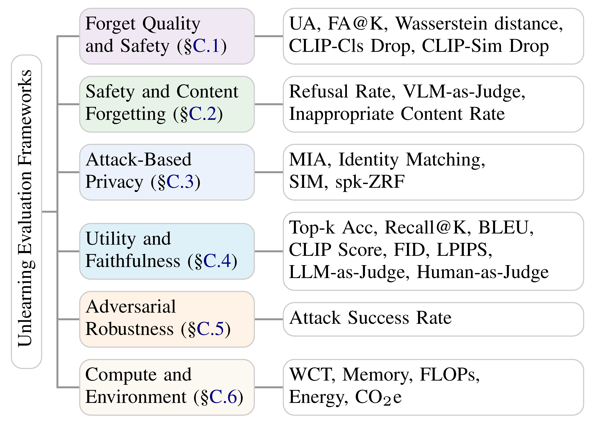
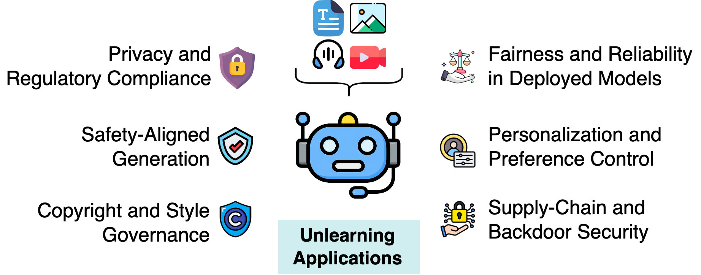
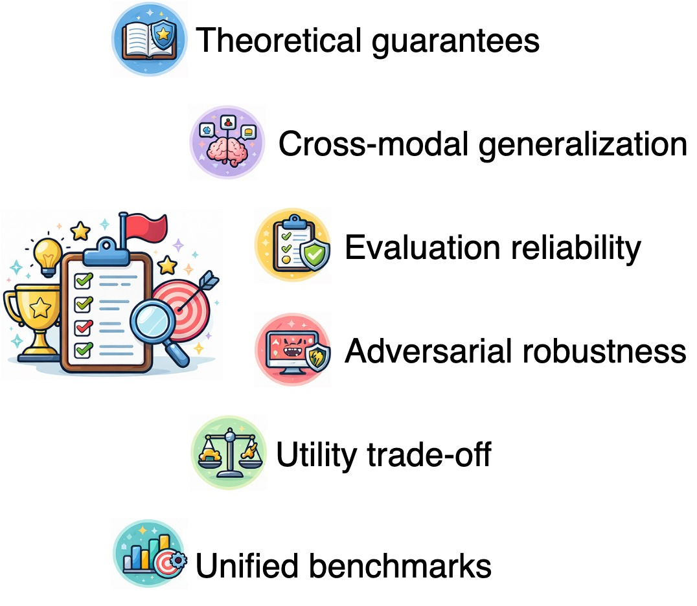
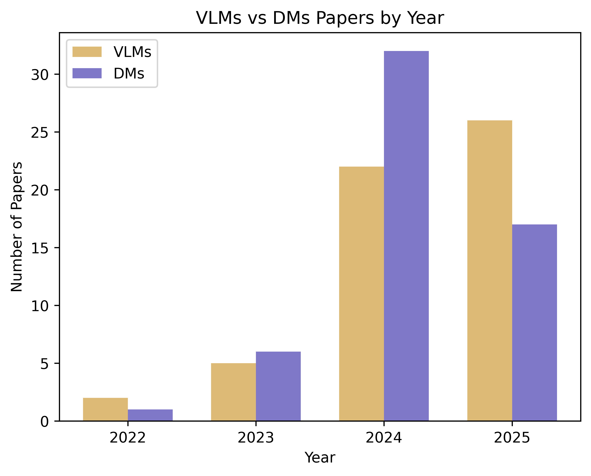

<h1 align="center">
  Multimodal Unlearning Across Vision, Language, Video, and Audio: Survey of Methods, Datasets, and Benchmarks
</h1>

<div align="center">
<a href="https://smsnobin77.github.io/Awesome-Multimodal-Unlearning/"></a>&nbsp;<!----><a href="https://aclanthology.org/2026.findings-acl.1379/"></a>&nbsp;<!----><a href="https://arxiv.org/abs/2607.07907"></a>&nbsp;<!----><a href="https://github.com/smsnobin77/Awesome-Multimodal-Unlearning/pulls"></a>
</div>
&nbsp;

> <strong>Authors</strong>: Nobin Sarwar<sup></sup>, Shubhashis Roy Dipta<sup></sup>, Zheyuan Liu<sup></sup>, Vaidehi Patil<sup></sup>  
> <strong>Affiliations</strong>:  University of Maryland, Baltimore County &nbsp;·&nbsp;  University of Notre Dame &nbsp;·&nbsp;  UNC Chapel Hill
                                                                   
> We welcome issues for any related work not discussed and will consider inclusion in future updates.

## 🎉 Latest News

- **[2026-04-06]** 🎉 Our **Multimodal Unlearning Survey** is **accepted as Findings at ACL 2026**. We will present this work at the **ACL 2026** in **San Diego, CA**.
- **[2026-02-28]** 🌐 We release the **[Project Page](https://smsnobin77.github.io/Awesome-Multimodal-Unlearning/)** for our **Multimodal Unlearning survey**.
- **[2026-02-14]** 🚀 We launch the **Awesome Multimodal Unlearning** repository to track methods, datasets, and benchmarks. Check it out: [GitHub](https://github.com/smsnobin77/Awesome-Multimodal-Unlearning)  
- **[2026-01-26]** 📄 Our survey on **Multimodal Unlearning** is released on TechRxiv. See the paper: [TechRxiv](http://dx.doi.org/10.36227/techrxiv.176945748.88280394/v1)

## 📌 Citation

If our work supports your research or applications, we would appreciate a ⭐ and a citation using the BibTeX below.

```bibtex
@inproceedings{sarwar-etal-2026-multimodal,
  title     = {{Multimodal Unlearning Across Vision, Language, Video, and Audio: Survey of Methods, Datasets, and Benchmarks}},
  author    = {Sarwar, Nobin and {Roy Dipta}, Shubhashis and Liu, Zheyuan and Patil, Vaidehi},
  booktitle = {Findings of the {A}ssociation for {C}omputational {L}inguistics: {ACL} 2026},
  year      = {2026},
  address   = {San Diego, California, USA},
  month     = jul,
  pages     = {27702--27730},
  publisher = {Association for Computational Linguistics},
  url       = {https://aclanthology.org/2026.findings-acl.1379/}
}
```

## 📚 Contents  
- [Latest News](#-latest-news)
- [Citation](#-citation)
- [Overview](#-overview)
- [Comparison with Existing Surveys](#-comparison-with-existing-surveys)
- [Taxonomy of Multimodal Unlearning](#-taxonomy-of-multimodal-unlearning)
- [Benchmarks for Multimodal Unlearning](#-benchmarks-for-multimodal-unlearning)
- [Evaluation Metrics](#-evaluation-metrics)
- [Applications of Multimodal Unlearning](#-applications-of-multimodal-unlearning)
- [Open Challenges in Multimodal Unlearning](#-open-challenges-in-multimodal-unlearning)
- [Curated Paper List](#-curated-paper-list)
- [Contributing](#-contributing)
- [Contact](#-contact)
- [✨ Star History](#-star-history)

## 🧭 Overview  

Multimodal unlearning requires identifying effective intervention points within the model pipeline. Figure 2 illustrates methods spanning data-side, training-time, architecture-constrained, and decoding-time stages, producing an updated model (MFM′). Training-free approaches instead apply direct parameter or representation edits (Δ).

<p align="center">
  
  <br/>
  <span style="font-size: 10px;">Figure 2: <b>System-level intervention points</b> for multimodal <br> unlearning across the model pipeline.</span>
</p>

## 📊 Comparison with Existing Surveys

While several surveys address multimodal unlearning, most remain limited to unimodal or text–image settings and adopt algorithm-centric taxonomies that overlook practical intervention points. **A unified cross-modal perspective remains lacking**; we therefore summarize representative surveys across **modalities** and **system-first taxonomy** coverage.

| Date | Title | Authors | Paper | System-first | Text | Image | Video | Audio |
|------|-------|-------------|--------|--------------|------|-------|-------|-------|
| 2023&#8209;11 | Knowledge Unlearning for LLMs: Tasks, Methods, and Challenges | Si et al. | [](https://arxiv.org/pdf/2311.15766) |  | ✓ |  |  |  |
| 2024&#8209;02 | Rethinking Machine Unlearning for Large Language Models | Liu et al. | [](https://arxiv.org/pdf/2402.08787) |  | ✓ |  |  |  |
| 2024&#8209;04 | Digital Forgetting in Large Language Models: A Survey of Unlearning Methods | Blanco-Justicia et al. | [](https://arxiv.org/pdf/2404.02062) | ✓ | ✓ |  |  |  |
| 2024&#8209;07 | Machine Unlearning in Generative AI: A Survey | Liu et al. | [](https://arxiv.org/pdf/2407.20516) | ✓ | ✓ | ✓ |  |  |
| 2025&#8209;03 | A Comprehensive Survey of Machine Unlearning Techniques for Large Language Models | Geng et al. | [](https://arxiv.org/pdf/2503.01854) | ✓ | ✓ | ✓ |  |  |
| 2025&#8209;07 | A Survey on Generative Model Unlearning: Fundamentals, Taxonomy, Evaluation, and Future Direction | Feng et al. | [](https://arxiv.org/pdf/2507.19894) | ✓ | ✓ | ✓ |  | ✓ |
| **2026&#8209;01** | **Ours** | - | - | **✓** | **✓** | **✓** | **✓** | **✓** |

## 📂 Taxonomy of Multimodal Unlearning

We organize multimodal unlearning via a **system-first taxonomy** across **five** intervention stages:

- **Data-Side Interventions (Section 3.1)** – Modify inputs or data distributions to reduce learnability of target content.  
- **Training-Time Edits (Section 3.2)** – Update model parameters to suppress target behavior.  
- **Architecture-Constrained Unlearning (Section 3.3)** – Localized updates within layers or structures.
- **Training-Free Unlearning (Section 3.4)** – Apply closed-form parameter or representation edits without retraining.  
- **Decoding-Time Unlearning (Section 3.5)** – Control generation without modifying model parameters.  

<p align="center">
  
  <br/>
  <span style="font-size: 10px;">Figure 1: Taxonomy of multimodal unlearning by <b>intervention stage</b> and <b>control pathway</b>.</span>
</p>

## 📈 Benchmarks for Multimodal Unlearning  

We organize representative multimodal unlearning benchmarks into **three** categories: **unified suites**, **identity and privacy**, and **content and knowledge**, based on their targets and evaluation focus (Table 3).

**🧪 Unified Benchmark Suites**

| Date | Title | Paper |
|------|-------|-------|
| 2025&#8209;12 | UMU-Bench: Closing the Modality Gap in Multimodal Unlearning Evaluation | [](https://openreview.net/pdf?id=M476xkfNXe) |
| 2025&#8209;03 | PEBench: A Fictitious Dataset to Benchmark Machine Unlearning for Multimodal Large Language Models | [](https://arxiv.org/pdf/2503.12545) |
| 2024&#8209;10 | Protecting Privacy in Multimodal Large Language Models with MLLMU-Bench | [](https://arxiv.org/pdf/2410.22108) |
| 2024&#8209;06 | MU-Bench: A Multitask Multimodal Benchmark for Machine Unlearning | [](https://arxiv.org/pdf/2406.14796) |

**🔐 Identity and Privacy Unlearning**

| Date | Title | Paper |
|------|-------|-------|
| 2025&#8209;05 | Alexa, can you forget me? Machine Unlearning Benchmark in Spoken Language Understanding | [](https://arxiv.org/pdf/2505.15700) |
| 2024&#8209;11 | Benchmarking Vision Language Model Unlearning via Fictitious Facial Identity Dataset | [](https://arxiv.org/pdf/2411.03554) |
| 2024&#8209;10 | CLEAR: Character Unlearning in Textual and Visual Modalities | [](https://arxiv.org/pdf/2410.18057) |

**📚 Content and Knowledge Unlearning**

| Date | Title | Paper |
|------|-------|-------|
| 2025&#8209;05 | Unlearning Sensitive Information in Multimodal LLMs: Benchmark and Attack-Defense Evaluation | [](https://arxiv.org/pdf/2505.01456) |
| 2025&#8209;02 | SafeEraser: Enhancing Safety in Multimodal Large Language Models through Multimodal Machine Unlearning | [](https://arxiv.org/pdf/2502.12520) |
| 2024&#8209;10 | Holistic Unlearning Benchmark: A Multi-Faceted Evaluation for Text-to-Image Diffusion Model Unlearning | [](https://arxiv.org/pdf/2410.05664) |
| 2024&#8209;06 | Six-CD: Benchmarking Concept Removals for Text-to-image Diffusion Models | [](https://arxiv.org/pdf/2406.14855) |
| 2024&#8209;05 | Single Image Unlearning: Efficient Machine Unlearning in Multimodal Large Language Models | [](https://arxiv.org/pdf/2405.12523) |
| 2024&#8209;03 | A Dataset and Benchmark for Copyright Infringement Unlearning from Text-to-Image Diffusion Models | [](https://arxiv.org/pdf/2403.12052) |
| 2024&#8209;02 | UnlearnCanvas: Stylized Image Dataset for Enhanced Machine Unlearning Evaluation in Diffusion Models | [](https://arxiv.org/pdf/2402.11846) |
  
## 📏 Evaluation Metrics  

Evaluation uses metric suites that assess forgetting, utility retention, robustness, and efficiency, as summarized in **Figure 3**. We defer detailed metric definitions and evaluation protocols to **Appendix B**.

<p align="center">
  
  <br/>
  <span style="font-size: 10px;">Figure 3: Evaluation dimensions and representative <br> metrics for multimodal unlearning.</span>
</p>

## 🧩 Applications of Multimodal Unlearning  

Multimodal unlearning enables selective removal of specific identities, attributes, or concepts without full retraining while preserving overall capability and stability. Detailed use cases and representative studies are provided in **Appendix E**.

<p align="center">
  
  <br/>
  <span style="font-size: 10px;">Figure 4: Core application scenarios of multimodal unlearning.</span>
</p>

## 🧩 Open Challenges in Multimodal Unlearning

Multimodal unlearning faces challenges in theory, generalization, evaluation, robustness, utility trade-offs, and benchmarking, limiting reliable and scalable deployment.

Further discussion is provided in **Appendix F**, covering modality-specific limitations, evaluation considerations, and emerging research directions.

<p align="center">
  
  <br/>
  <span style="font-size: 10px;">Figure 5: Key open challenges in multimodal unlearning.</span>
</p>


## 📑 Curated Paper List  


<p align="center">
  
  <br/>
  <span style="font-size: 10px;">Figure: Year-wise distribution of the first 111-paper list across VLMs and DMs, 2022 to 2025 (through August 2025).</span>
</p>

<!-- papers:start -->
We list **138 papers**, grouped by where they act in the model pipeline (Section 3 of the survey). Search, filter, and export them in the [interactive explorer](https://smsnobin77.github.io/Awesome-Multimodal-Unlearning/explorer/).

- [Data-side](#data-side) (6)
- [Training-time](#training-time) (29)
- [Architecture-constrained](#architecture-constrained) (6)
- [Training-free](#training-free) (7)
- [Decoding-time](#decoding-time) (10)
- [Benchmarks](#benchmarks) (13)
- [Attacks](#attacks) (7)
- [Other work discussed in the survey](#other-work-discussed-in-the-survey) (46)
- [Surveys](#surveys) (6)
- [Not yet placed](#not-yet-placed) (8)

### Data-side

#### Data-path perturbation

| Date | Title | Model | Paper |
|------|-------|-------|-------|
| 2024&#8209;10 | UnSeg: one universal unlearnable example generator is enough against all image segmentation |  | [](https://arxiv.org/abs/2410.09909) |
| 2024&#8209;07 | **MEM**: Multimodal unlearnable examples: Protecting data against multimodal contrastive learning | CLIP | [](https://arxiv.org/abs/2407.16307) |
| 2023&#8209;11 | Metacloak: Preventing unauthorized subject-driven text-to-image diffusion-based synthesis via meta-learning | Diffusion | [](https://arxiv.org/abs/2311.13127) |
| 2023&#8209;01 | **UCs**: Unlearnable clusters: Towards label-agnostic unlearnable examples | CLIP | [](https://arxiv.org/abs/2301.01217) |

#### Data hygiene and prompt normalization

| Date | Title | Model | Paper |
|------|-------|-------|-------|
| 2023&#8209;03 | Cleanclip: Mitigating data poisoning attacks in multimodal contrastive learning | CLIP | [](https://arxiv.org/abs/2303.03323) |
| 2022&#8209;09 | **Homoglyph Bias**: Exploiting cultural biases via homoglyphs intext-to-image synthesis | Diffusion | [](https://img.shields.io/badge/arXiv-B31B1B?style=flat-square&logo=arxiv&logoColor=white) |

### Training-time

#### Direct gradient

| Date | Title | Model | Paper |
|------|-------|-------|-------|
| 2025&#8209;09 | No Encore: Unlearning as Opt-Out in Music Generation | Audio | [](https://arxiv.org/abs/2509.06277) |
| 2025&#8209;08 | Unleashing Uncertainty: Efficient Machine Unleanring for Generative AI | Diffusion | [](https://img.shields.io/badge/arXiv-B31B1B?style=flat-square&logo=arxiv&logoColor=white) |
| 2025&#8209;08 | Unlearning LLM-Based Speech Recognition Models | Audio | [](https://img.shields.io/badge/paper-555555?style=flat-square&logo=readthedocs&logoColor=white) |
| 2025&#8209;07 | **NCU**: Unlearning the Noisy Correspondence Makes CLIP More Robust | CLIP | [](https://arxiv.org/abs/2507.03434) |
| 2025&#8209;07 | Quantum-Inspired Audio Unlearning: Towards Privacy-Preserving Voice Biometrics | Audio | [](https://arxiv.org/abs/2507.22208) |
| 2025&#8209;07 | Do Not Mimic My Voice: Speaker Identity Unlearning for Zero-Shot Text-to-Speech | Audio | [](https://arxiv.org/abs/2507.20140) |
| 2024&#8209;07 | Unlearning Concepts from Text-to-Video Diffusion Models | Video, Diffusion | [](https://arxiv.org/abs/2407.14209) |
| 2024&#8209;07 | Direct unlearning optimization for robust and safe text-to-image models | Diffusion | [](https://arxiv.org/abs/2407.21035) |
| 2024&#8209;05 | **SIU**: Single image unlearning: Efficient machine unlearning in multimodal large language models | VLM | [](https://arxiv.org/abs/2405.12523) |
| 2024&#8209;04 | Safegen: Mitigating unsafe content generation in text-to-image models | Diffusion | [](https://arxiv.org/abs/2404.06666) |
| 2024&#8209;03 | **Unlearn Backdoors**: Unlearning backdoor threats: Enhancing backdoor defense in multimodal contrastive learning via local token unlearning | CLIP | [](https://arxiv.org/abs/2403.16257) |
| 2024&#8209;02 | EFUF: Efficient Fine-Grained Unlearning Framework for Mitigating Hallucinations in Multimodal Large Language Models | VLM | [](https://arxiv.org/abs/2402.09801) |
| 2023&#8209;11 | Multidelete for multimodal machine unlearning | VLM | [](https://arxiv.org/abs/2311.12047) |
| 2023&#8209;03 | Ablating concepts in text-to-image diffusion models | Diffusion | [](https://arxiv.org/abs/2303.13516) |

#### Constrained updates

| Date | Title | Model | Paper |
|------|-------|-------|-------|
| 2025&#8209;07 | Loreun: Data itself implicitly provides cues to improve machine unlearning | Diffusion | [](https://arxiv.org/abs/2507.22499) |
| 2025&#8209;03 | Data Unlearning in Diffusion Models | Diffusion | [](https://arxiv.org/abs/2503.01034) |
| 2024&#8209;12 | Boosting alignment for post-unlearning text-to-image generative models | Diffusion | [](https://arxiv.org/abs/2412.07808) |
| 2024&#8209;11 | Munba: Machine unlearning via nash bargaining | CLIP, Diffusion | [](https://arxiv.org/abs/2411.15537) |
| 2024&#8209;08 | Controllable Unlearning for Image-to-Image Generative Models via ε-Constrained Optimization | Diffusion | [](https://arxiv.org/abs/2408.01689) |
| 2024&#8209;05 | Multi-Modal Recommendation Unlearning for Legal, Licensing, and Modality Constraints |  | [](https://arxiv.org/abs/2405.15328) |

#### Mask-driven selective unlearning

| Date | Title | Model | Paper |
|------|-------|-------|-------|
| 2025&#8209;07 | **KSCU**: Concept Unlearning by Modeling Key Steps of Diffusion Process | Diffusion | [](https://arxiv.org/abs/2507.06526) |
| 2025&#8209;04 | Sculpting memory: Multi-concept forgetting in diffusion models via dynamic mask and concept-aware optimization | Diffusion | [](https://arxiv.org/abs/2504.09039) |
| 2025&#8209;04 | **SAU**: Backdoor Defense in Diffusion Models via Spatial Attention Unlearning | Diffusion | [](https://arxiv.org/abs/2504.18563) |
| 2025&#8209;02 | MMUnlearner: Reformulating Multimodal Machine Unlearning in the Era of Multimodal Large Language Models | VLM | [](https://arxiv.org/abs/2502.11051) |
| 2023&#8209;10 | Salun: Empowering machine unlearning via gradient-based weight saliency in both image classification and generation | Diffusion | [](https://arxiv.org/abs/2310.12508) |
| 2023&#8209;03 | Forget-me-not: Learning to forget in text-to-image diffusion models | Diffusion | [](https://arxiv.org/abs/2303.17591) |

#### Distillation-based

| Date | Title | Model | Paper |
|------|-------|-------|-------|
| 2025&#8209;08 | **SKD-CAG**: Sealing The Backdoor: Unlearning Adversarial Text Triggers In Diffusion Models Using Knowledge Distillation | Diffusion | [](https://arxiv.org/abs/2508.18235) |
| 2024&#8209;09 | **SFD**: Score Forgetting Distillation: A Swift, Data-Free Method for Machine Unlearning in Diffusion Models | Diffusion | [](https://arxiv.org/abs/2409.11219) |
| 2023&#8209;07 | **SSD**: Towards safe self-distillation of internet-scale text-to-image diffusion models | Diffusion | [](https://arxiv.org/abs/2307.05977) |

### Architecture-constrained

#### Architecture editing

| Date | Title | Model | Paper |
|------|-------|-------|-------|
| 2025&#8209;02 | **MANU**: Modality-aware neuron pruning for unlearning in multimodal large language models | VLM | [](https://arxiv.org/abs/2502.15910) |
| 2025&#8209;02 | **Audio Unlearning**: Machine Unlearning in Audio: Bridging The Modality Gap Via the Prune and Regrow Paradigm | Audio | [](https://openreview.net/forum?id=i3tBySZWrR) |
| 2024&#8209;12 | Efficient fine-tuning and concept suppression for pruned diffusion models | Diffusion | [](https://arxiv.org/abs/2412.15341) |
| 2024&#8209;05 | Freezeasguard: Mitigating illegal adaptation of diffusion models via selective tensor freezing | Diffusion | [](https://arxiv.org/abs/2405.17472) |

#### Layer-scoped constrained updates

| Date | Title | Model | Paper |
|------|-------|-------|-------|
| 2024&#8209;11 | Model integrity when unlearning with t2i diffusion models | Diffusion | [](https://arxiv.org/abs/2411.02068) |
| 2024&#8209;07 | **SLUG**: Targeted Unlearning with Single Layer Unlearning Gradient | CLIP, Diffusion, VLM | [](https://arxiv.org/abs/2407.11867) |

### Training-free

#### Weight-space linear unlearning

| Date | Title | Model | Paper |
|------|-------|-------|-------|
| 2025&#8209;06 | Video Unlearning via Low-Rank Refusal Vector | Video | [](https://arxiv.org/abs/2506.07891) |
| 2024&#8209;10 | NegMerge: Consensual Weight Negation for Strong Machine Unlearning | CLIP | [](https://img.shields.io/badge/arXiv-B31B1B?style=flat-square&logo=arxiv&logoColor=white) |
| 2024&#8209;06 | Diffusion Soup: Model Merging for Text-to-Image Diffusion Models | Diffusion | [](https://arxiv.org/abs/2406.08431) |
| 2022&#8209;12 | **Task Arithmetic**: Editing models with task arithmetic | CLIP | [](https://arxiv.org/abs/2212.04089) |

#### Representation projection

| Date | Title | Model | Paper |
|------|-------|-------|-------|
| 2025&#8209;05 | CURE: Concept Unlearning via Orthogonal Representation Editing in Diffusion Models | Diffusion | [](https://arxiv.org/abs/2505.12677) |
| 2025&#8209;03 | **Motion Unlearning**: Human Motion Unlearning | Video | [](https://arxiv.org/abs/2503.18674) |
| 2023&#8209;11 | Safe-CLIP: Removing NSFW Concepts from Vision-and-Language Models | CLIP | [](https://arxiv.org/abs/2311.16254) |

### Decoding-time

#### Guidance-path control

| Date | Title | Model | Paper |
|------|-------|-------|-------|
| 2025&#8209;08 | UnGuide: Learning to Forget with LoRA-Guided Diffusion Models | Diffusion | [](https://arxiv.org/abs/2508.05755) |
| 2025&#8209;08 | Steering guidance for personalized text-to-image diffusion models | Diffusion | [](https://arxiv.org/abs/2508.00319) |
| 2025&#8209;03 | Detect-and-Guide: Self-regulation of Diffusion Models for Safe Text-to-Image Generation via Guideline Token Optimization | Diffusion | [](https://arxiv.org/abs/2503.15197) |
| 2024&#8209;10 | SAFREE: Training-Free and Adaptive Guard for Safe Text-to-Image And Video Generation | Video, Diffusion | [](https://arxiv.org/abs/2410.12761) |
| 2024&#8209;10 | **DNG**: Dynamic Negative Guidance of Diffusion Models | Diffusion | [](https://arxiv.org/abs/2410.14398) |

#### Conditioning-path control

| Date | Title | Model | Paper |
|------|-------|-------|-------|
| 2024&#8209;10 | Steerdiff: Steering towards safe text-to-image diffusion models | Diffusion | [](https://arxiv.org/abs/2410.02710) |
| 2024&#8209;08 | Moderator: Moderating text-to-image diffusion models through fine-grained context-based policies | Diffusion | [](https://arxiv.org/abs/2408.07728) |
| 2024&#8209;03 | Hiding and Recovering Knowledge in Text-to-Image Diffusion Models via Learnable Prompts | Diffusion | [](https://arxiv.org/abs/2403.12326) |
| 2024&#8209;03 | CPR: Retrieval augmented generation for copyright protection | Diffusion | [](https://arxiv.org/abs/2403.18920) |
| 2024&#8209;02 | **SuppressEOT**: Get What You Want, Not What You Don't: Image Content Suppression for Text-to-Image Diffusion Models | Diffusion | [](https://img.shields.io/badge/arXiv-B31B1B?style=flat-square&logo=arxiv&logoColor=white) |

### Benchmarks

| Date | Title | Model | Paper |
|------|-------|-------|-------|
| 2025&#8209;12 | UMU-Bench: Closing the Modality Gap in Multimodal Unlearning Evaluation | VLM | [](https://img.shields.io/badge/paper-555555?style=flat-square&logo=readthedocs&logoColor=white) |
| 2025&#8209;05 | **UnSLU-BENCH**: “Alexa, can you forget me?” Machine Unlearning Benchmark in Spoken Language Understanding | Audio | [](https://arxiv.org/abs/2505.15700) |
| 2025&#8209;05 | **UnLOK-VQA**: Unlearning Sensitive Information in Multimodal LLMs: Benchmark and Attack-Defense Evaluation | VLM | [](https://arxiv.org/abs/2505.01456) |
| 2025&#8209;03 | Pebench: A fictitious dataset to benchmark machine unlearning for multimodal large language models | VLM | [](https://arxiv.org/abs/2503.12545) |
| 2025&#8209;02 | Safeeraser: Enhancing safety in multimodal large language models through multimodal machine unlearning | VLM | [](https://arxiv.org/abs/2502.12520) |
| 2024&#8209;11 | **FIUBench**: Benchmarking vision language model unlearning via fictitious facial identity dataset | VLM | [](https://arxiv.org/abs/2411.03554) |
| 2024&#8209;10 | **MLLMU-Bench**: Protecting Privacy in Multimodal Large Language Models with MLLMU-Bench | VLM | [](https://arxiv.org/abs/2410.22108) |
| 2024&#8209;10 | Holistic unlearning benchmark: A multi-faceted evaluation for text-to-image diffusion model unlearning | Diffusion | [](https://arxiv.org/abs/2410.05664) |
| 2024&#8209;10 | Clear: Character unlearning in textual and visual modalities | VLM | [](https://arxiv.org/abs/2410.18057) |
| 2024&#8209;06 | Six-CD: Benchmarking Concept Removals for Text-to-image Diffusion Models | Diffusion | [](https://img.shields.io/badge/arXiv-B31B1B?style=flat-square&logo=arxiv&logoColor=white) |
| 2024&#8209;06 | Mu-bench: A multitask multimodal benchmark for machine unlearning | Audio, Video | [](https://arxiv.org/abs/2406.14796) |
| 2024&#8209;03 | **CPDM**: A Dataset and Benchmark for Copyright Protection from Text-to-Image Diffusion Models | Diffusion | [](https://arxiv.org/abs/2403.12052) |
| 2024&#8209;02 | Unlearncanvas: A stylized image dataset to benchmark machine unlearning for diffusion models | Diffusion | [](https://arxiv.org/abs/2402.11846) |

### Attacks

| Date | Title | Model | Paper |
|------|-------|-------|-------|
| 2025&#8209;07 | Image Can Bring Your Memory Back: A Novel Multi-Modal Guided Attack against Image Generation Model Unlearning | Diffusion | [](https://arxiv.org/abs/2507.07139) |
| 2025&#8209;06 | SUA: Stealthy Multimodal Large Language Model Unlearning Attack | VLM | [](https://arxiv.org/abs/2506.17265) |
| 2025&#8209;06 | Does Multimodal Large Language Model Truly Unlearn? Stealthy MLLM Unlearning Attack | VLM | [](https://arxiv.org/abs/2506.17265) |
| 2024&#8209;08 | DiffZOO: A Purely Query-Based Black-Box Attack for Red-teaming Text-to-Image Generative Model via Zeroth Order Optimization | Diffusion | [](https://arxiv.org/abs/2408.11071) |
| 2024&#8209;05 | Automatic Jailbreaking of the Text-to-Image Generative AI Systems | Diffusion | [](https://arxiv.org/abs/2405.16567) |
| 2024&#8209;04 | Probing unlearned diffusion models: A transferable adversarial attack perspective | Diffusion | [](https://arxiv.org/abs/2404.19382) |
| 2023&#8209;11 | Badclip: Dual-embedding guided backdoor attack on multimodal contrastive learning | CLIP | [](https://arxiv.org/abs/2311.12075) |

### Other work discussed in the survey

| Date | Title | Model | Paper |
|------|-------|-------|-------|
| 2025&#8209;12 | Unconsciously Forget: Mitigating Memorization; Without Knowing What is being Memorized |  | [](https://arxiv.org/abs/2512.09687) |
| 2025&#8209;12 | MedForget: Hierarchy-Aware Multimodal Unlearning Testbed for Medical AI | VLM | [](https://arxiv.org/abs/2512.09867) |
| 2025&#8209;08 | VideoEraser: Concept Erasure in Text-to-Video Diffusion Models | Video, Diffusion | [](https://arxiv.org/abs/2508.15314) |
| 2025&#8209;07 | Towards Resilient Safety-driven Unlearning for Diffusion Models against Downstream Fine-tuning | Diffusion | [](https://arxiv.org/abs/2507.16302) |
| 2025&#8209;07 | PULSE: Practical Evaluation Scenarios for Large Multimodal Model Unlearning | VLM | [](https://arxiv.org/abs/2507.01271) |
| 2025&#8209;06 | Speech Unlearning | Audio | [](https://arxiv.org/abs/2506.00848) |
| 2025&#8209;04 | The Dual Power of Interpretable Token Embeddings: Jailbreaking Attacks and Defenses for Diffusion Model Unlearning | Diffusion | [](https://arxiv.org/abs/2504.21307) |
| 2025&#8209;04 | Prompting Forgetting: Unlearning in GANs via Textual Guidance | Diffusion | [](https://arxiv.org/abs/2504.01218) |
| 2025&#8209;03 | Safety mirage: How spurious correlations undermine vlm safety fine-tuning | VLM | [](https://arxiv.org/abs/2503.11832) |
| 2025&#8209;02 | SEMU: Singular Value Decomposition for Efficient Machine Unlearning | VLM | [](https://arxiv.org/abs/2502.07587) |
| 2025&#8209;01 | Zero-shot CLIP class forgetting via text-image space adaptation | CLIP | [](https://img.shields.io/badge/paper-555555?style=flat-square&logo=readthedocs&logoColor=white) |
| 2025&#8209;01 | SAeUron: Interpretable Concept Unlearning in Diffusion Models with Sparse Autoencoders | Diffusion | [](https://arxiv.org/abs/2501.18052) |
| 2025 | Efficient and adaptive recommendation unlearning: A guided filtering framework to erase outdated preferences |  | [](https://doi.org/10.1145/3706633) |
| 2024&#8209;12 | Precise, fast, and low-cost concept erasure in value space: Orthogonal complement matters | Diffusion | [](https://arxiv.org/abs/2412.06143) |
| 2024&#8209;12 | Memories of forgotten concepts | Diffusion | [](https://arxiv.org/abs/2412.00782) |
| 2024&#8209;11 | Vlsbench: Unveiling visual leakage in multimodal safety | VLM | [](https://arxiv.org/abs/2411.19939) |
| 2024&#8209;10 | Unstable Unlearning: The Hidden Risk of Concept Resurgence in Diffusion Models | Diffusion | [](https://arxiv.org/abs/2410.08074) |
| 2024&#8209;10 | Meta-unlearning on diffusion models: Preventing relearning unlearned concepts | Diffusion | [](https://arxiv.org/abs/2410.12777) |
| 2024&#8209;10 | Cliperase: Efficient unlearning of visual-textual associations in clip | CLIP | [](https://arxiv.org/abs/2410.23330) |
| 2024&#8209;09 | Unlearning or concealment? a critical analysis and evaluation metrics for unlearning in diffusion models | Diffusion | [](https://arxiv.org/abs/2409.05668) |
| 2024&#8209;09 | Enhancing User-Centric Privacy Protection: An Interactive Framework through Diffusion Models and Machine Unlearning | Diffusion | [](https://arxiv.org/abs/2409.03326) |
| 2024&#8209;09 | Efficient backdoor defense in multimodal contrastive learning: A token-level unlearning method for mitigating threats | CLIP | [](https://arxiv.org/abs/2409.19526) |
| 2024&#8209;07 | Zero-shot class unlearning in clip with synthetic samples | CLIP | [](https://arxiv.org/abs/2407.07485) |
| 2024&#8209;07 | On large language model continual unlearning |  | [](https://arxiv.org/abs/2407.10223) |
| 2024&#8209;06 | MUC: Machine Unlearning for Contrastive Learning with Black-box Evaluation | CLIP | [](https://arxiv.org/abs/2406.03603) |
| 2024&#8209;06 | Large language model unlearning via embedding-corrupted prompts |  | [](https://arxiv.org/abs/2406.07933) |
| 2024&#8209;06 | Can Textual Unlearning Solve Cross-Modality Safety Alignment? | VLM | [](https://img.shields.io/badge/arXiv-B31B1B?style=flat-square&logo=arxiv&logoColor=white) |
| 2024&#8209;05 | Unlearning concepts in diffusion model via concept domain correction and concept preserving gradient | Diffusion | [](https://arxiv.org/abs/2405.15304) |
| 2024&#8209;03 | Mace: Mass concept erasure in diffusion models | Diffusion | [](https://arxiv.org/abs/2403.06135) |
| 2024&#8209;03 | CLIP the Bias: How Useful is Balancing Data in Multimodal Learning? | CLIP | [](https://arxiv.org/abs/2403.04547) |
| 2024&#8209;02 | Visual In-Context Learning for Large Vision-Language Models | VLM | [](https://img.shields.io/badge/arXiv-B31B1B?style=flat-square&logo=arxiv&logoColor=white) |
| 2024&#8209;02 | Machine unlearning for image-to-image generative models | Diffusion | [](https://arxiv.org/abs/2402.00351) |
| 2024&#8209;02 | Learning the unlearned: Mitigating feature suppression in contrastive learning | CLIP | [](https://arxiv.org/abs/2402.11816) |
| 2024&#8209;01 | Adaptive Median Smoothing: Adversarial Defense for Unlearned Text-to-Image Diffusion Models at Inference Time | Diffusion | [](https://img.shields.io/badge/paper-555555?style=flat-square&logo=readthedocs&logoColor=white) |
| 2024 | Leveraging catastrophic forgetting to develop safe diffusion models against malicious finetuning | Diffusion | [](https://doi.org/10.52202/079017-3658) |
| 2023&#8209;08 | Unified concept editing in diffusion models | Diffusion | [](https://arxiv.org/abs/2308.14761) |
| 2023&#8209;06 | Training data attribution for diffusion models | Diffusion | [](https://arxiv.org/abs/2306.02174) |
| 2023&#8209;04 | Model sparsity can simplify machine unlearning |  | [](https://arxiv.org/abs/2304.04934) |
| 2023&#8209;03 | Erasing concepts from diffusion models | Diffusion | [](https://arxiv.org/abs/2303.07345) |
| 2022&#8209;12 | Pre-trained encoders in self-supervised learning improve secure and privacy-preserving supervised learning | CLIP | [](https://arxiv.org/abs/2212.03334) |
| 2021&#8209;03 | Remember what you want to forget: Algorithms for machine unlearning |  | [](https://arxiv.org/abs/2103.03279) |
| 2020&#8209;07 | Descent-to-delete: Gradient-based methods for machine unlearning |  | [](https://arxiv.org/abs/2007.02923) |
| 2019&#8209;12 | Machine unlearning |  | [](https://arxiv.org/abs/1912.03817) |
| 2019&#8209;11 | Certified Data Removal from Machine Learning Models |  | [](https://arxiv.org/abs/1911.03030) |
| 2019&#8209;07 | Making ai forget you: Data deletion in machine learning |  | [](https://arxiv.org/abs/1907.05012) |
| 2015 | Towards making systems forget with machine unlearning |  | [](https://doi.org/10.1109/sp.2015.35) |

### Surveys

| Date | Title | Model | Paper |
|------|-------|-------|-------|
| 2025&#8209;07 | A survey on generative model unlearning: Fundamentals, taxonomy, evaluation, and future direction |  | [](https://arxiv.org/abs/2507.19894) |
| 2025&#8209;03 | A comprehensive survey of machine unlearning techniques for large language models |  | [](https://arxiv.org/abs/2503.01854) |
| 2024&#8209;07 | Machine unlearning in generative ai: A survey |  | [](https://arxiv.org/abs/2407.20516) |
| 2024&#8209;04 | Digital forgetting in large language models: A survey of unlearning methods |  | [](https://arxiv.org/abs/2404.02062) |
| 2024&#8209;02 | Rethinking machine unlearning for large language models |  | [](https://arxiv.org/abs/2402.08787) |
| 2023&#8209;11 | Knowledge unlearning for llms: Tasks, methods, and challenges |  | [](https://arxiv.org/abs/2311.15766) |

### Not yet placed

| Date | Title | Model | Paper |
|------|-------|-------|-------|
| 2025&#8209;07 | Automating Evaluation of Diffusion Model Unlearning with (Vision-) Language Model World Knowledge | Diffusion | [](https://img.shields.io/badge/arXiv-B31B1B?style=flat-square&logo=arxiv&logoColor=white) |
| 2025&#8209;06 | Rethinking Post-Unlearning Behavior of Large Vision-Language Models | VLM | [](https://img.shields.io/badge/arXiv-B31B1B?style=flat-square&logo=arxiv&logoColor=white) |
| 2025&#8209;06 | Quantifying Cross-Modality Memorization in Vision-Language Models | VLM | [](https://img.shields.io/badge/arXiv-B31B1B?style=flat-square&logo=arxiv&logoColor=white) |
| 2025&#8209;06 | Lifting Data-Tracing Machine Unlearning to Knowledge-Tracing for Foundation Models | VLM | [](https://img.shields.io/badge/arXiv-B31B1B?style=flat-square&logo=arxiv&logoColor=white) |
| 2025&#8209;06 | Large-Scale Training Data Attribution for Music Generative Models via Unlearning | Audio | [](https://img.shields.io/badge/arXiv-B31B1B?style=flat-square&logo=arxiv&logoColor=white) |
| 2025&#8209;01 | Rethinking Bottlenecks in Safety Fine-Tuning of Vision Language Models | VLM | [](https://img.shields.io/badge/arXiv-B31B1B?style=flat-square&logo=arxiv&logoColor=white) |
| 2024&#8209;12 | Learning to Forget using Hypernetworks | Diffusion | [](https://img.shields.io/badge/arXiv-B31B1B?style=flat-square&logo=arxiv&logoColor=white) |
| 2024&#8209;08 | On the Limitations and Prospects of Machine Unlearning for Generative AI | Audio, Diffusion | [](https://img.shields.io/badge/arXiv-B31B1B?style=flat-square&logo=arxiv&logoColor=white) |
<!-- papers:end -->

## 🤝 Contributing

Please read the [contributing.md](contributing.md) before submitting a pull request.

## 📧 Contact

This repository is actively maintained and continuously updated 🚀. If you notice any issues or would like your work on Multimodal Unlearning included, please open an issue or contact us via email.

**Corresponding author:** Nobin Sarwar (smsarwar96@gmail.com)

---

## ✨ Star History

[](https://www.star-history.com/#smsnobin77/Awesome-Multimodal-Unlearning&Date)

---

<div align="center">

  **⭐ If you find this repository useful, please consider starring it! ⭐**
  
  [](https://github.com/smsnobin77/Awesome-Multimodal-Unlearning)
  [](https://github.com/smsnobin77/Awesome-Multimodal-Unlearning)

</div>

---

<p align="center">
  <em>Thanks for visiting ✨ Awesome Multimodal Unlearning</em><br><br>
  
</p>
